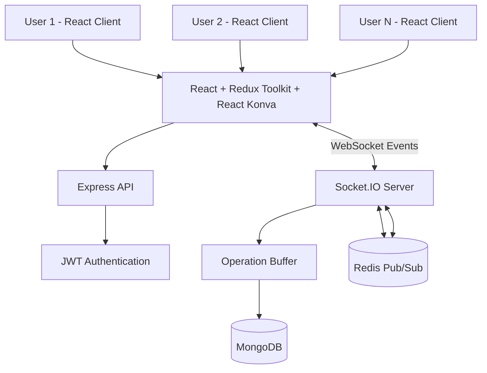

# BoardCollab – Real-Time Collaborative Whiteboard

A real-time collaborative whiteboard application built using the MERN stack. BoardCollab allows multiple users to work together on a shared canvas, create and edit visual elements, and collaborate through real-time communication.

The application supports room-based collaboration, authentication, drawing tools, undo/redo, persistent storage, and Redis-based Socket.IO scaling.

---

## 1. Project Overview

BoardCollab is designed to provide a shared digital workspace where multiple users can collaborate on a whiteboard simultaneously.

Users can create or join rooms, draw using different tools, view other participants' changes in real time, and recover their work after refreshing or reconnecting.

### Key Objectives

- Provide real-time multi-user collaboration.
- Support public and private whiteboard rooms.
- Maintain persistent whiteboard data using MongoDB.
- Handle concurrent editing operations.
- Support undo and redo functionality.
- Provide scalable real-time communication using Redis.
- Support exporting whiteboards into PNG and SVG formats.

---

## 2. Technology Stack

| Component | Technology |
|---|---|
| Frontend | React, Vite |
| State Management | Redux Toolkit |
| Canvas Rendering | React Konva |
| Backend | Node.js, Express.js |
| Database | MongoDB |
| Database ODM | Mongoose |
| Real-time Communication | Socket.IO |
| Authentication | JSON Web Token (JWT) |
| Scaling | Redis, Socket.IO Redis Adapter |
| Testing | Jest, React Testing Library |
| Infrastructure | Docker, Docker Compose |

---

## 3. Application Features

### Authentication and Authorization
- User registration and login.
- JWT-based authentication.
- Protected application and room access.
- Public and private room permissions.

### Collaborative Whiteboard
- Real-time drawing and editing.
- Freehand drawing.
- Rectangle tool.
- Circle tool.
- Text tool.
- Live cursor and participant presence updates.
- Multiple users working in the same room.

### Collaboration and Synchronization
- Socket.IO-based real-time communication.
- Operation-based updates.
- Operation validation.
- Conflict-handling support.
- Per-user undo and redo.
- Heartbeat communication.
- Reconnection and offline recovery.

### Persistence
- MongoDB-backed room and element storage.
- Whiteboard restoration after refresh.
- Batched operation persistence.
- Support for large whiteboard sessions.

### Export
- Export whiteboards as PNG.
- Export whiteboards as SVG.

### Scalability
- Redis Pub/Sub integration.
- Socket.IO Redis Adapter.
- Multiple backend instances.
- Cross-instance room event communication.

---

## 4. System Architecture

The application follows a client-server architecture.



### Architecture Description

1. React provides the user interface and whiteboard canvas.
2. Redux Toolkit manages frontend application state.
3. React Konva handles canvas rendering and interaction.
4. Express exposes backend API endpoints.
5. JWT middleware protects authenticated routes and socket connections.
6. Socket.IO manages real-time collaboration events.
7. The operation buffer batches incoming changes before persistence.
8. MongoDB stores sessions and whiteboard elements.
9. Redis enables communication between multiple Socket.IO server instances.

---

## 5. Project Structure

```text
BoardCollab/
│
├── client/
│   ├── public/
│   ├── src/
│   │   ├── components/
│   │   ├── features/
│   │   ├── pages/
│   │   ├── services/
│   │   ├── store/
│   │   └── ...
│   ├── package.json
│   └── vite.config.js
│
├── server/
│   ├── scripts/
│   ├── src/
│   │   ├── config/
│   │   ├── middleware/
│   │   ├── models/
│   │   ├── routes/
│   │   ├── services/
│   │   ├── sockets/
│   │   ├── app.js
│   │   └── index.js
│   ├── package.json
│   └── ...
│
├── docker-compose.yml
├── .gitignore
└── README.md
```

---

## 6. Prerequisites

Install the following before running the project:

- Node.js
- npm
- Docker Desktop
- Git

MongoDB and Redis can be started using Docker Compose.

---

## 7. Installation and Setup

### Step 1: Clone the Repository

```bash
git clone <YOUR_GITHUB_REPOSITORY_URL>
cd BoardCollab
```

### Step 2: Start MongoDB and Redis

From the project root:

```bash
docker compose up -d
```

Check running containers:

```bash
docker compose ps
```

Default service ports:

| Service | Port |
|---|---:|
| MongoDB | 27017 |
| Redis | 6379 |

### Step 3: Configure Backend Environment

Create `server/.env`:

```env
NODE_ENV=development
PORT=4000

MONGO_URI=mongodb://localhost:27017/boardcollab
REDIS_URL=redis://localhost:6379

JWT_SECRET=replace_with_a_secure_random_secret
JWT_EXPIRES_IN=7d

CLIENT_ORIGIN=http://localhost:5173
```

Use a unique, strong JWT secret. Never commit the actual `.env` file.

### Step 4: Install Backend Dependencies

```bash
cd server
npm install
```

Start the backend:

```bash
npm run dev
```

The backend runs on:

```text
http://localhost:4000
```

### Step 5: Install Frontend Dependencies

Open another terminal:

```bash
cd client
npm install
```

Configure any frontend environment variables required by the existing client configuration.

Start the frontend:

```bash
npm run dev
```

The frontend runs on:

```text
http://localhost:5173
```

---

## 8. Docker Services

The root-level `docker-compose.yml` provides the supporting infrastructure.

Start services:

```bash
docker compose up -d
```

Stop services:

```bash
docker compose down
```

Stop services and remove persisted Docker volumes:

```bash
docker compose down -v
```

**Warning:** The last command deletes the MongoDB data stored in the Docker volume.

---

## 9. Real-Time Collaboration

Socket.IO is used to exchange events between connected users.

The application supports events for:

- Joining and leaving rooms.
- Drawing operations.
- Element updates.
- Cursor position updates.
- Presence synchronization.
- Heartbeat communication.
- Reconnection and state recovery.

Redis Pub/Sub and the Socket.IO Redis Adapter allow events to be shared between backend instances.

The application has been manually tested with two backend instances and cross-instance communication.

---

## 10. Data Persistence and Large Sessions

MongoDB stores whiteboard sessions and their elements.

A 10,000-element seed test was executed to verify that the database can store a large whiteboard session.

### Verified Database Result

| Metric | Result |
|---|---:|
| Seeded room | `load-10k-1794902094131` |
| Session documents | 1 |
| Element documents | 10,000 |
| Database verification | Successful |

The result was verified using MongoDB document counts.

This confirms the 10,000-element data seeding and storage test. It does not, by itself, establish a 10,000-element rendering or concurrent-user performance benchmark.

---

## 11. Testing

### Backend Tests

Run from the `server` directory:

```bash
npm test -- --coverage
```

Latest recorded results:

| Metric | Result |
|---|---:|
| Test suites passed | 2 |
| Tests passed | 10 |
| Statement coverage | 44.15% |
| Branch coverage | 41.29% |
| Function coverage | 33.33% |
| Line coverage | 47.76% |

### Frontend Tests

Run from the `client` directory:

```bash
npm test
```

Latest recorded results:

| Metric | Result |
|---|---:|
| Test files passed | 4 |
| Tests passed | 13 |
| Statement coverage | 29.03% |
| Branch coverage | 79.61% |
| Function coverage | 31.88% |
| Line coverage | 29.03% |

Coverage figures represent the latest recorded test runs and may change as additional tests are added.

### Production Build

Run from the `client` directory:

```bash
npm run build
```

The production build completed successfully in the latest recorded run.

---

## 12. Load Testing

The project includes scripts for preparing a 10,000-element session and testing Socket.IO communication.

### Seed a Large Session

From the `server` directory:

```bash
npm run seed:10k
```

### Run the Socket.IO Load Test

Configure the required room ID and authentication token values locally, then run:

```bash
npm run load
```

The load-test script supports:

- Configurable virtual user count.
- Configurable test duration.
- Socket connection and room joining.
- Operation acknowledgements.
- Peer delivery tracking.
- Average acknowledgement latency.
- p95 acknowledgement and delivery latency.

**Performance reporting:** Record the actual output of the load test before reporting concurrent-user capacity or latency benchmarks. The 50+ concurrent-user target is a target, not a verified result in this submission.

---

## 13. Known Limitations and Future Improvements

- Increase backend and frontend automated test coverage.
- Complete and document a 50+ concurrent-user load test.
- Measure latency and throughput under different workloads.
- Add further automated tests for reconnection and failure scenarios.
- Strengthen persistence guarantees for queued operations during unexpected server termination.
- Expand offline-first support using Service Workers and IndexedDB.
- Add AI-based shape recognition.
- Improve monitoring and production logging.

---

## 14. Security Considerations

- JWT-based authentication.
- Protected private-room access.
- Server-side validation of drawing operations.
- Environment-based configuration.
- Restricted CORS origin.
- Do not commit environment files or secrets.
- Use HTTPS and secure deployment configuration in production.

---

## 15. Running the Application

Start the infrastructure:

```bash
docker compose up -d
```

Start the backend:

```bash
cd server
npm run dev
```

Start the frontend in another terminal:

```bash
cd client
npm run dev
```

Open:

```text
http://localhost:5173
```

---

## 16. Conclusion

BoardCollab demonstrates a full-stack real-time collaborative application using the MERN ecosystem.

It combines interactive canvas rendering, authenticated room-based collaboration, real-time event synchronization, persistent storage, undo/redo functionality, export capabilities, and Redis-based multi-instance communication.

The project provides a foundation for collaborative visual workspaces and can be extended with additional scalability, offline-first capabilities, and intelligent drawing features.